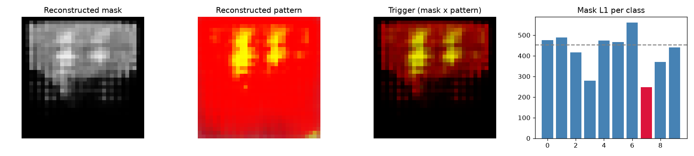

# Model Security Report: clean_6
**Verdict:** NO STRONG EVIDENCE OF BACKDOOR  
**P(backdoor):** 0.22 (UNCALIBRATED heuristic (run make_zoo.py first))  
**Suspected target class:** 7  
**Clean accuracy on scan set:** 8.2%

## Evidence
- quiet - Trigger search (Neural Cleanse): class 7: mask-size anomaly index 3.66 (>2 suspicious); using only 3% of pixels its trigger still flips 7% of fresh clean inputs vs 1% for the median class; mask is 0.54x the median class mask
- quiet - Behavioural: random-patch hijack: a single random patch pushed 13% of inputs into one class
- **FIRED** - Behavioural: STRIP entropy test: under blending, triggered inputs keep 68% lower entropy than clean ones (trigger survives blending)
- quiet - Activation: neuron elevation (ABS-style): one label is driven by a single channel with outlier elevation score 1.21
- quiet - Activation: spectral signature / clustering: triggered inputs separate from genuine target inputs (spectral AUC 0.85, cluster agreement 0.83)

